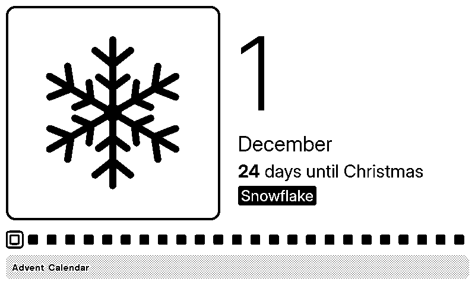
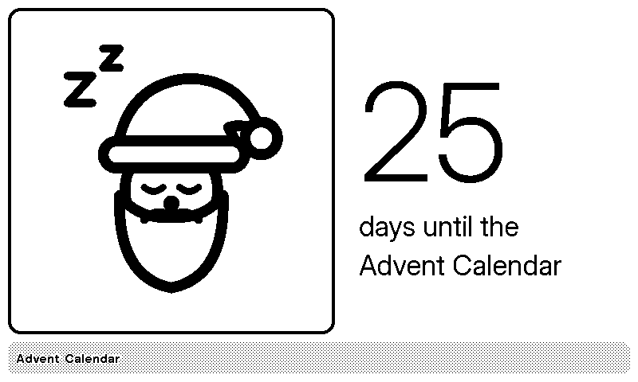

#  TRMNL Advent Calendar

A daily advent calendar for [TRMNL](https://trmnl.com) e-ink displays.




When not in December, a sleeping Santa is shown with a countdown to when the Advent
calendar starts. In the month of December, a different Christmas-themed image is shown
for each day, with a row/column of little doors being opened along the way.

All modes (full, half horizontal, half vertical, and quadrant) are supported. Light and
dark mode are both supported. And portrait and landscape modes are both supported.

## License

[MIT](LICENSE)

## Development

### Running trmnl

You can run it with today's date:

```
trmnlp serve
```

Or install `faketime` to pick a date to show, e.g.

```
faketime '2008-12-07 08:15:42' trmnlp serve
```

### Seeing all possible outputs

Render every day in every view, light and dark, landscape and portrait:

```
trmnlp test dev/gallery_spec.rb --report gallery
```

Then open `gallery/index.html`. Add devices with e.g. `DEVICES=og_png,v2` (default `og_png`).
